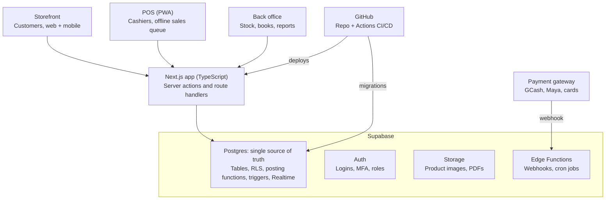

# E-Commerce + POS + Inventory + Accounting — System Design

Oct 11, 2026 · Nomer

## Overview

Version 1 is one web app that sells online and in-store from a single stock pool, and every sale, purchase and stock movement posts its own double-entry journal. One database (Supabase Postgres) is the source of truth for orders, stock and the books, so the storefront, the POS and the reports never disagree.

**In scope for v1**

- Online storefront: catalog, cart, checkout, pickup or delivery, order tracking
- In-store POS: cashier screen, barcode, receipts, shifts and cash drawer
- Inventory: multi-location stock, receiving, transfers, adjustments, reorder alerts, lot and expiry tracking
- Basic accounting: chart of accounts, automatic journals, AR/AP, VAT, P&L, balance sheet, trial balance
- Back office: products, pricing, customers, suppliers, users and roles

**Out of scope for v1:** payroll, manufacturing/BOM, full fixed-asset register, multi-currency.

**Assumptions**

- One company to start, with several branches or warehouses. The schema carries a `company_id` so a second company can be added later.
- Currency is PHP and output VAT is 12%, with VAT-exempt and zero-rated items supported.
- Products can be sold by piece or by weight (per kg), so a meat line fits without schema changes.
- Inventory is valued at moving weighted-average cost.

## Tech stack and architecture

One Next.js app serves all three front ends, and all business rules live in Supabase Postgres, so the POS and the storefront cannot post a sale differently.



Every money or stock change goes through a Postgres function; GitHub Actions is the only path that changes the schema or deploys code.

| Layer | Choice | Why |
| --- | --- | --- |
| Frontend | Next.js + TypeScript, Tailwind, shadcn/ui | One codebase for storefront, POS and admin; first-class Supabase client support |
| POS runtime | Installable PWA with IndexedDB | Runs on any PC or tablet browser; works offline |
| Database | Supabase Postgres | Transactions, constraints and functions keep the books and stock consistent |
| Auth | Supabase Auth + custom JWT claims | Roles and branch scope available to RLS |
| Server logic | Postgres functions (RPC) + Supabase Edge Functions | Posting in SQL; webhooks, emails and scheduled jobs in Edge Functions |
| Files | Supabase Storage | Product images, receipt and invoice PDFs |
| Live updates | Supabase Realtime | New online orders appear on POS and back office without refresh |
| Hosting | Vercel (or self-hosted Node) | Preview deploy per pull request |
| Source and CI/CD | GitHub + GitHub Actions + Supabase CLI | Migrations reviewed and applied from the repo |
| Hardware | ESC/POS receipt printer, barcode scanner (keyboard mode), scale via Web Serial | Works from the browser without drivers on most setups |

## Modules and features

Five modules share one product, stock and customer master; each feature below is a v1 requirement.

| Module | Users | v1 features |
| --- | --- | --- |
| Storefront | Customers | Catalog with categories and search; product page with price per piece or per kg; cart; guest or account checkout; pickup branch or delivery address with delivery fee; online payment (GCash, Maya, card) or COD; order status page and email/SMS updates; order history |
| POS | Cashiers, supervisors | Fast item lookup by barcode, PLU or name; scale input for weighed items; discounts with supervisor PIN; senior/PWD discount; split tender (cash, card, e-wallet); print or email receipt; void and refund with approval; hold and recall sale; shift open/close with cash count and X/Z reading |
| Inventory | Warehouse, purchasing | Stock per location; purchase orders and receiving (partial receipts); lot number and expiry per receipt, FEFO picking; transfers between locations with in-transit state; stock adjustments with reason codes (spoilage, shrink, count variance); cycle counts; reorder point alerts; full stock movement ledger |
| Accounting | Accountant, owner | Chart of accounts; automatic journals from every transaction; manual journal entries; customer invoices and AR aging; supplier bills and AP aging; payments and receipts; bank/cash accounts; period close and lock; VAT summary |
| Back office | Admin, managers | Products, variants, units and price lists; branch-specific pricing; customers and suppliers; users, roles and branch assignment; tax codes; receipt and invoice settings; audit log |

## Roles and permissions

Access is enforced in the database with Row Level Security, not only in the UI, so a leaked API key or a crafted request cannot read another branch's data.

| Role | Can do | Data scope |
| --- | --- | --- |
| Owner | Everything, including period close and user admin | All branches |
| Admin | Master data, users, settings | All branches |
| Accountant | Journals, AR/AP, payments, reports, period close | All branches, read-only on POS |
| Branch manager | Approve voids/refunds/discounts, transfers, adjustments, branch reports | Assigned branches |
| Cashier | Sell, open/close own shift, reprint receipt | Own shift, assigned branch |
| Warehouse | Receive, transfer, count, adjust (adjustments need approval) | Assigned locations |
| Customer | Browse, order, view own orders and profile | Own records |

**How it is built**

- Supabase Auth issues the login; a `user_roles` table maps each user to a role and to branches.
- A custom access-token hook copies role and branch IDs into the JWT, so RLS policies read them without extra queries.
- Every table has RLS on. Policies follow one pattern: `branch_id = any(auth.branch_ids())` plus a role check.
- Money- and stock-changing actions run only through `security definer` Postgres functions (e.g. `post_pos_sale`), never direct table writes from the client.
- The service-role key lives only in Edge Functions and CI secrets, never in the browser.

## Database schema

About 35 tables in five groups. Every table has `id uuid`, `company_id`, `created_at`, `created_by`, and posted documents are never edited, only reversed.

| Group | Table | Key columns |
| --- | --- | --- |
| Org | companies | name, tin, vat_registered, address |
| Org | branches | company_id, code, name, type (store, warehouse, online hub) |
| Org | user_roles | user_id, role, branch_ids[] |
| Catalog | products | sku, name, category_id, base_uom, sold_by (piece, weight), tax_code_id, track_lots, is_active |
| Catalog | product_variants | product_id, barcode, plu, name, uom, conversion_to_base |
| Catalog | price_lists, prices | channel (online, pos), branch_id, variant_id, price, valid_from, valid_to |
| Catalog | categories, tax_codes | name, parent_id; code, rate, type (vatable, exempt, zero-rated) |
| Parties | customers | name, email, phone, tin, is_senior_pwd, credit_limit, terms_days |
| Parties | customer_addresses | customer_id, label, address, geo, is_default |
| Parties | suppliers | name, tin, terms_days, vat_registered |
| Inventory | stock_locations | branch_id, name |
| Inventory | lots | variant_id, lot_no, expiry_date, received_at |
| Inventory | stock_moves | location_id, variant_id, lot_id, qty (+/−), unit_cost, move_type, source_doc_type, source_doc_id |
| Inventory | stock_balances | location_id, variant_id, lot_id, qty_on_hand, qty_reserved, avg_cost (kept by trigger on stock_moves) |
| Inventory | purchase_orders, po_lines | supplier_id, branch_id, status; variant_id, qty, unit_cost |
| Inventory | goods_receipts, gr_lines | po_id, received_at; variant_id, lot_no, expiry, qty, unit_cost |
| Inventory | transfers, transfer_lines | from_location, to_location, status (draft, in_transit, received) |
| Inventory | adjustments, adjustment_lines | location_id, reason, approved_by; qty_change |
| Sales | orders, order_lines | channel (online, pos), branch_id, customer_id, status, subtotal, discount, vat, total |
| Sales | payments | order_id or invoice_id, method, amount, reference, status, gateway_payload |
| Sales | shifts | branch_id, terminal_id, cashier_id, opening_cash, closing_cash, expected_cash, z_reading_no |
| Sales | receipts | order_id, receipt_no (gapless per terminal), printed_count |
| Sales | returns, return_lines | order_id, reason, approved_by; qty, restock (yes/no) |
| Sales | deliveries | order_id, address_id, fee, rider, status, delivered_at |
| Accounting | accounts | code, name, type (asset, liability, equity, revenue, expense), parent_id, is_postable |
| Accounting | journal_entries | date, period_id, source_doc_type, source_doc_id, memo, status, reversed_by |
| Accounting | journal_lines | entry_id, account_id, debit, credit, branch_id, partner_id |
| Accounting | fiscal_periods | year, month, status (open, closed) |
| Accounting | invoices, bills | customer_id or supplier_id, due_date, total, balance |
| Accounting | bank_accounts | account_id, bank, number_last4 |
| System | audit_log | table, row_id, action, old, new, user_id, at |
| System | doc_sequences | doc_type, branch_id, terminal_id, next_no |

**Integrity rules enforced in Postgres**

- A constraint trigger rejects any journal entry where total debits ≠ total credits.
- Journals cannot post into a closed `fiscal_period`.
- `stock_balances.qty_on_hand` cannot go negative unless the branch setting allows it.
- Receipt numbers come from `doc_sequences` under a row lock, so they stay gapless.

## Core workflows

Each workflow ends in one Postgres function call that writes the document, the stock moves and the journal in a single transaction, so either all three land or none do.

**Online order**

1. Customer checks out; `create_online_order` reserves stock (`qty_reserved`) at the fulfilling branch.
2. Online payment: the gateway webhook hits an Edge Function, which verifies the signature and calls `confirm_payment`. COD skips this step.
3. Staff pick (FEFO lots), pack, and mark ready or out for delivery.
4. On pickup or delivery, `fulfill_order` turns the reservation into a stock-out and posts revenue, VAT and COGS.
5. Unpaid orders auto-cancel after a set time and release the reservation.

**POS sale**

1. Cashier opens a shift with opening cash.
2. Items are scanned or weighed; prices come from the branch's POS price list.
3. Tender is taken (split allowed); `post_pos_sale` writes order, payment, stock-out, receipt number and journal at once.
4. Receipt prints; voids before tender need no approval, refunds after tender need a manager PIN.
5. Shift close: cashier counts cash, system shows expected vs counted, and the over/short posts to its own account.

**Purchasing and receiving**

1. Purchasing raises a PO to a supplier.
2. Warehouse receives against it, partial receipts allowed, entering lot and expiry.
3. `post_goods_receipt` adds stock at cost, updates average cost, and accrues the liability to GRNI.
4. Accountant enters the supplier bill; it clears GRNI to accounts payable and books input VAT.
5. Payment to supplier clears AP against cash or bank.

**Returns and refunds**

1. Return is raised against the original order or receipt, with reason.
2. Manager approves; items are flagged restock or write-off.
3. `post_return` reverses revenue and VAT, refunds the tender, and either restocks at original cost or books spoilage.

**Stock transfer**

1. Source branch creates a transfer; on dispatch stock moves to an in-transit location.
2. Destination receives and confirms quantities; any shortage posts as a variance adjustment.
3. No journal is needed unless branches are separate profit centers (then a branch-tagged entry).

**Stock adjustment and count**

1. Warehouse records a count or adjustment with a reason code.
2. Manager approves; `post_adjustment` moves stock and posts the loss or gain at average cost.

## Accounting rules

The accountant never re-keys sales or stock: each event below posts automatically, and only adjustments outside these events are manual journals.

**Starter chart of accounts**

| Code | Account | Type |
| --- | --- | --- |
| 1010 | Cash on hand – per branch | Asset |
| 1020 | Cash in bank | Asset |
| 1030 | Payment gateway clearing (GCash, Maya, card) | Asset |
| 1100 | Accounts receivable | Asset |
| 1200 | Inventory | Asset |
| 1210 | Inventory in transit | Asset |
| 1300 | Input VAT | Asset |
| 2010 | Accounts payable | Liability |
| 2020 | Goods received not invoiced (GRNI) | Liability |
| 2100 | Output VAT payable | Liability |
| 2200 | Customer deposits / unearned revenue | Liability |
| 3000 | Owner's equity | Equity |
| 3100 | Retained earnings | Equity |
| 4010 | Sales – online | Revenue |
| 4020 | Sales – POS | Revenue |
| 4030 | Delivery fee income | Revenue |
| 4100 | Sales discounts (incl. senior/PWD) | Contra-revenue |
| 4200 | Sales returns | Contra-revenue |
| 5010 | Cost of goods sold | Expense |
| 5020 | Inventory shrinkage and spoilage | Expense |
| 5030 | Inventory count variance | Expense |
| 6010 | Payment gateway fees | Expense |
| 6020 | Cash over/short | Expense |

**Automatic journal entries**

| Event | Debit | Credit |
| --- | --- | --- |
| POS sale, cash | 1010 Cash on hand (total); 5010 COGS (avg cost) | 4020 Sales – POS (net); 2100 Output VAT; 1200 Inventory (avg cost) |
| POS sale, card or e-wallet | 1030 Gateway clearing; 5010 COGS | 4020 Sales; 2100 Output VAT; 1200 Inventory |
| Online order paid (before fulfilment) | 1030 Gateway clearing | 2200 Customer deposits |
| Online order fulfilled | 2200 Customer deposits (or 1100 AR if COD/credit); 5010 COGS | 4010 Sales – online; 4030 Delivery fee; 2100 Output VAT; 1200 Inventory |
| Gateway settlement | 1020 Cash in bank; 6010 Gateway fees | 1030 Gateway clearing |
| Goods receipt | 1200 Inventory | 2020 GRNI |
| Supplier bill | 2020 GRNI; 1300 Input VAT | 2010 Accounts payable |
| Supplier payment | 2010 Accounts payable | 1020 Cash in bank |
| Customer return, restocked | 4200 Sales returns; 2100 Output VAT; 1200 Inventory | 1010/1030 refund tender; 5010 COGS |
| Return written off / spoilage | 5020 Shrinkage and spoilage | 1200 Inventory |
| Transfer dispatched / received | 1210 In transit, then 1200 Inventory (dest.) | 1200 Inventory (source), then 1210 In transit |
| Count variance (loss) | 5030 Count variance | 1200 Inventory |
| Shift cash short | 6020 Cash over/short | 1010 Cash on hand |

**VAT handling**

- Shelf prices are VAT-inclusive; net = price ÷ 1.12 for vatable items. Exempt and zero-rated items carry their own tax code.
- Senior citizen and PWD sales remove the 12% VAT first, then apply the 20% discount on the VAT-exclusive price; the discount posts to 4100.
- The VAT summary report gives output VAT, input VAT and net payable per month for the VAT return.

**Period close:** the accountant reconciles cash and gateway clearing, reviews the trial balance, then locks the month. Corrections after lock go into the next open period as reversing entries.

## Reports

V1 ships 16 reports, all filterable by date range and branch and exportable to CSV/Excel. Heavy ones read from Postgres views or materialized views refreshed nightly.

| Area | Report | Main user |
| --- | --- | --- |
| Sales | Daily sales by branch, channel and payment method | Owner, manager |
| Sales | Sales by product and category, with margin | Owner, purchasing |
| Sales | Cashier shift report, X/Z reading | Manager, accountant |
| Sales | Discounts, voids and refunds log | Manager, auditor |
| Sales | Online orders by status and fulfilment time | Manager |
| Inventory | Stock on hand and value by location | Warehouse, accountant |
| Inventory | Stock movement ledger per item | Warehouse |
| Inventory | Near-expiry and expired lots | Warehouse, manager |
| Inventory | Reorder list (below reorder point) | Purchasing |
| Inventory | Shrinkage, spoilage and count variance | Owner, manager |
| Accounting | Trial balance | Accountant |
| Accounting | Income statement (P&L), by branch | Owner, accountant |
| Accounting | Balance sheet | Owner, accountant |
| Accounting | General ledger detail per account | Accountant |
| Accounting | AR and AP aging | Accountant |
| Accounting | VAT summary (output, input, net payable) | Accountant |

A dashboard home page shows today's sales, open online orders, low-stock count and cash position.

## Repo, environments and CI/CD

One GitHub monorepo holds the app and the database; every schema change is a SQL migration file reviewed in a pull request and applied by GitHub Actions, never edited by hand in the Supabase dashboard.

**Repo layout**

```
pos-erp/
  apps/
    web/                 Next.js app: storefront, POS, back office (route groups)
      app/(store)/       public storefront
      app/(pos)/         cashier screen, PWA
      app/(admin)/       inventory, accounting, settings, reports
  packages/
    db/                  generated Supabase types, query helpers
    ui/                  shared components
  supabase/
    migrations/          timestamped SQL: tables, RLS, functions, triggers
    functions/           Edge Functions: payment-webhook, send-receipt, nightly-jobs
    seed.sql             chart of accounts, tax codes, demo data
    tests/               pgTAP tests for posting functions and RLS
  .github/workflows/
    ci.yml
    deploy.yml
```

**Environments**

| Environment | Supabase | App hosting | Trigger |
| --- | --- | --- | --- |
| Local | `supabase start` (Docker) | `next dev` | Developer machine |
| Preview | Supabase branch per PR | Preview deployment per PR | Pull request opened |
| Staging | Staging project | staging domain | Merge to `develop` |
| Production | Production project | production domain | Merge to `main` |

**Pipeline**

1. `ci.yml` on every PR: lint, type-check, unit tests, `supabase db reset` on a throwaway database, pgTAP tests (journals balance, RLS blocks cross-branch reads), then a Next.js build.
2. `deploy.yml` on merge: `supabase db push` applies new migrations to the target project, deploys Edge Functions, then deploys the web app.
3. Secrets (`SUPABASE_ACCESS_TOKEN`, project refs, DB password, gateway keys) live in GitHub Environments with required reviewers on Production.
4. Branch protection on `main`: PR review and green CI required.

## Security, backups and offline POS

The biggest operational risk is a store losing internet mid-shift, so the POS is designed to keep selling offline and sync later.

**Offline POS**

- The POS is a PWA. Products, prices and the cashier's session are cached in IndexedDB on each terminal.
- Offline sales get a terminal-prefixed receipt number from a pre-allocated block, so numbers never collide.
- A local queue holds sales; on reconnect each one is sent to `post_pos_sale` with an idempotency key, so a retry never posts twice.
- Card and e-wallet payments need connectivity; offline mode accepts cash only and the screen shows an offline banner.
- Stock can briefly go negative after an offline sync; the negative-stock report flags it for the manager.

**Security**

- RLS on every table; posting only through `security definer` functions (see Roles).
- Staff accounts use email/password with MFA required for Owner, Admin and Accountant; cashiers sign in on the terminal with a PIN tied to their account.
- Payment card data never touches our servers: the gateway's hosted checkout handles it.
- Webhooks are verified by signature before any order is marked paid.
- `audit_log` captures every insert, update and delete on master and accounting tables via trigger.
- Supabase security and performance advisors run in CI; findings block the merge.

**Backups and recovery**

- Supabase daily backups on the paid plan; point-in-time recovery enabled for Production.
- A nightly GitHub Action also runs `pg_dump` to an off-platform storage bucket, kept 30 days.
- A restore to Staging is tested once a quarter.

## Roadmap and open questions

Build order follows data dependency: the ledger and stock engine come first, because the POS and storefront are only screens on top of them.

| Phase | Delivers | Done when |
| --- | --- | --- |
| 0. Foundation | Repo, CI/CD, Supabase projects, auth, roles, RLS pattern, chart of accounts, tax codes | A PR deploys to Staging automatically; RLS tests pass |
| 1. Catalog and inventory | Products, variants, price lists, locations, POs, receiving, lots, transfers, adjustments, stock ledger | Stock on hand matches a manual count at one test branch |
| 2. Accounting core | Journals, posting functions, AR/AP, payments, trial balance, P&L, balance sheet, period lock | Receiving and bills post balanced journals; trial balance ties to stock value |
| 3. POS | Cashier screen, scale and barcode, tenders, receipts, shifts, voids/refunds, offline mode | One branch runs a full week on the POS with cash reconciled daily |
| 4. Storefront | Catalog, cart, checkout, payment gateway, delivery, order tracking | Paid online orders fulfil from branch stock and post revenue correctly |
| 5. Reports and go-live | All 16 reports, dashboard, data migration of opening balances, staff training | Opening balances loaded; first month closed in the system |

**Open questions**

- [ ] Is this for one of the group companies or a new business, and how many branches go live first?
- [ ] Which payment gateway: PayMongo, Xendit or another? This decides the webhook and settlement design.
- [ ] BIR registration path for the POS (permit to use / CAS accreditation) and the required receipt and Z-reading format.
- [ ] Which scale and receipt printer models are at the stores (affects serial/USB integration)?
- [ ] Delivery: own riders, third-party courier, or both? Is the fee flat, by zone or by distance?
- [ ] Should branches be separate profit centers with their own P&L?
- [ ] App hosting for Next.js: Vercel, or your own server alongside the existing Laravel apps?
- [ ] Opening balances: export from the current system, or start from a stock count and a trial balance?
